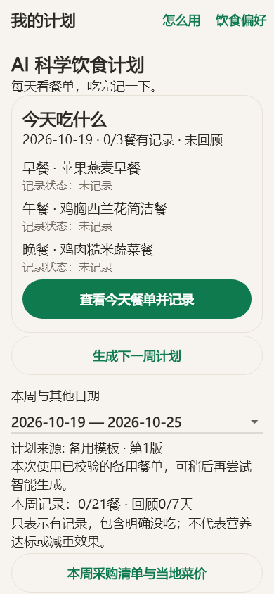
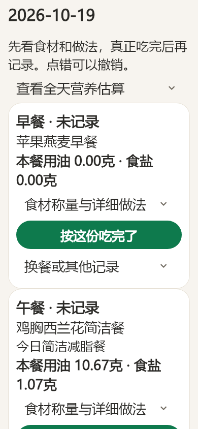

<p align="center">
  
</p>

<p align="center">
  <strong>中文 · 安卓手机 · AI 餐单 · 本地记录</strong><br />
  面向高血压合并肥胖老年人的饮食规划与记录工具，当前优先优化男性使用场景。
</p>

<p align="center">
  <a href="LICENSE"></a>
  
  
  <a href="https://github.com/Bluuok/scientific-weight-loss-app/actions/workflows/default_workflow.yml"></a>
</p>

<p align="center">
  <a href="#从计划到一顿饭">使用流程</a> ·
  <a href="#界面预览">界面预览</a> ·
  <a href="#ai-如何参与">AI 工作方式</a> ·
  <a href="#运行与构建">运行与构建</a> ·
  <a href="#隐私与密钥">隐私与密钥</a>
</p>

## 让一份计划真正走进厨房

“今天吃什么、每种放多少、油盐怎么称、做完如何记录”，是这个项目优先解决的问题。

**科学饮食**基于 [OpenNutriTracker](https://github.com/simonoppowa/OpenNutriTracker) 二次开发，将 AI 周餐单、30 天参考方向、食材克数、家常做法、饮食记录与采购清单连接起来。家人可以协助建立资料和配置服务，日常操作围绕 **看今天的餐单 → 按量准备 → 吃完记录 → 回顾调整** 展开。

项目只维护 **Android 手机端**。界面以中文、大字体和明确的主操作为重点；仓库保留的 iOS 等工程来自上游，不属于本分支支持的产品范围。

## 从计划到一顿饭

| 步骤 | 使用者看到什么 | 程序做什么 |
| :-- | :-- | :-- |
| **01 · 建立资料** | 为自己或家人分别设置身体资料、目标和饮食偏好 | 隔离不同家庭成员的计划与记录 |
| **02 · 核对健康风险** | 简短中文问卷，确认需要专业评估的情况 | 风险或不确定项会阻止普通减重餐单生成 |
| **03 · 生成一周餐单** | 在月度参考方向下查看未来七天的安排 | 结合已知资料、偏好、历史记录和可用食谱生成并复核 |
| **04 · 照着准备三餐** | 每种食材的克数、称量状态、每餐油盐和具体做法 | 食材、份量与做法同步换算 |
| **05 · 如实记录与回顾** | 完成、换餐、明确没吃，点错可以撤销 | 同步饮食日记，保留已执行餐次，统计记录覆盖情况 |
| **06 · 准备下一次采购** | 一周原料汇总和当地价格输入 | 按人民币 / 500 克计算；缺价时不显示完整预算 |

## 界面预览

<table align="center">
  <tr>
    <td align="center" width="50%"></td>
    <td align="center" width="50%"></td>
  </tr>
  <tr>
    <td align="center"><strong>每天先看今天吃什么</strong><br /><sub>餐单、状态和主操作放在一起</sub></td>
    <td align="center"><strong>每顿饭都可以落实到克数</strong><br /><sub>油盐重点展示，食材与做法按需展开</sub></td>
  </tr>
</table>

<sub>以上为 Flutter 界面测试生成的开发预览，使用模拟资料，包含 [PR #8](https://github.com/Bluuok/scientific-weight-loss-app/pull/8) 的界面改动；不含真实家庭成员资料。主题、字号和机型会影响实际显示。</sub>

## 核心能力

- **跨周衔接的餐单**：以 30 天参考方向组织每周计划，利用已知饮食记录改善轮换，不把未记录推断为没吃。
- **可以照做的家常餐**：当前内置 **26 种有来源的食材、28 道组合食谱**，呈现生重 / 干重、每餐油盐及制作步骤。
- **真实记录优先**：调整剩余餐单时保留过去日期和已记录餐次；完成与撤销同步到日记。
- **健康风险筛查**：覆盖血压控制、肾病、血钾相关风险、吞咽、衰弱、非自愿消瘦与特殊饮食；生成前后均检查状态。
- **四阶段记录复盘**：分开统计按计划、替换、明确没吃和未知记录，记录覆盖率不等于减重成功率。
- **家庭采购预算**：根据计划份量汇总原料，使用家人手工录入的当地菜价；不让 AI 猜测实时价格。
- **家庭资料隔离**：沿用上游本地加密 Hive 存储，每位家庭成员分别保存计划、价格和记录。

## AI 如何参与

AI 接收内置系统提示词与精简上下文，从允许的食谱中安排餐次；营养计算、份量边界和历史保护由本地代码复核。


| 层次 | 职责 | 代码入口 |
| :-- | :-- | :-- |
| 提示词与上下文 | 约束角色、轮换、证据使用和输出格式 | [planning_prompt.dart](lib/features/meal_planner/domain/planning_prompt.dart) |
| 服务调用 | DeepSeek 默认入口、兼容接口、授权确认与请求处理 | [meal_planning_service.dart](lib/features/meal_planner/data/meal_planning_service.dart) |
| 本地规则 | 独立核算餐单、检查允许食谱与份量 | [planner.dart](lib/features/meal_planner/domain/planner.dart) |
| 记录协调 | 资料隔离、生成一致性、已执行餐次保护和日记同步 | [planner_repository.dart](lib/features/meal_planner/data/planner_repository.dart) |
| 可执行做法 | 从食谱原料和份量生成克数与步骤 | [recipe_steps.dart](lib/features/meal_planner/domain/recipe_steps.dart) |

上游保留的文本 / 图片 AI 辅助是另一条可选流程，见 [AI 辅助架构](docs/ai-architecture.md)。

未配置服务时可使用明确标识的备用餐单；存在可行性或校验问题时不会悄悄放宽规则。备用模板与 AI 生成在界面上区分显示。

## 健康与数据边界

本项目提供饮食参考和记录功能，**不提供疾病诊断、用药调整或个体化医学处方，也没有经过临床疗效验证**。健康核对全部选择“没有”，不代表血压或肾功能已经检查正常。

- 当前食材来自 USDA FoodData Central，来源编号、链接和营养字段经过本地完整性检查。
- 钾、钙、镁、磷、饱和脂肪等未采集指标保持未知，不按零处理，也不宣称完整营养达标。
- 30 天是计划组织与习惯复盘框架，不承诺固定减重公斤数或血压变化。
- 中国本地食物成分数据需确认授权与原料匹配后接入；不把国外某一种原料直接等同于所有国内商品。

相关依据、实现与限制见 [食物数据来源](docs/nutrition-data-provenance-2026.md)、[健康风险筛查](docs/medical-risk-screen-2026.md)、[家常餐证据](docs/meal-planner-evidence-and-budget.md)、[月度记录复盘](docs/monthly-feedback-evidence-2026.md) 和 [采购预算](docs/grocery-budget-2026.md)。

## 隐私与密钥

| 内容 | 处理方式 |
| :-- | :-- |
| 家庭资料与日记 | 保存在本机，沿用上游加密存储机制 |
| AI 调用 | 经服务披露确认后，将必要的资料、偏好和近期记录摘要发送给所选服务商 |
| 自定义 AI 服务 | 客户端仅访问你填写的服务地址；点击获取模型列表和分析食物时都会发出请求。客户端不在这条路径额外请求第三方，服务端的存储或转发由其部署决定 |
| API Key | 由使用者自行配置，应用内配置使用系统安全存储；私有构建可读取本地 `.env` |
| 公开源码与 CI | 仅提供占位配置，不提供共享 API Key，不提交私有安装包或真实资料 |

**对外分发请使用不内置共享密钥的构建。** 客户端内置的密钥可能被提取；不要把带个人密钥的家庭自用 APK 上传到公开仓库或 Release。`.env`、生成的 `env.g.dart`、本地测试输出及安装包不应提交。

## 运行与构建

准备 Flutter **3.44.6**、JDK **21** 与 Android SDK。SDK 版本以项目配置为准；常用命令可参考 [AGENTS.md](AGENTS.md) 与 [安卓项目范围](docs/android-project-scope.md)。

```bash
git clone https://github.com/Bluuok/scientific-weight-loss-app.git
cd scientific-weight-loss-app

cp .env.example .env
flutter pub get
dart run intl_utils:generate
dart run build_runner build --delete-conflicting-outputs

flutter test test/features/meal_planner
flutter build apk --debug --flavor develop
```

`.env.example` 中的值是占位符；需要外部服务时请使用自己的配置。餐单 AI 也可以在应用的“饮食偏好 → 高级设置（家人协助）”中设置，并完成服务披露确认。本项目不提供公共 API 额度。

Windows 本地可使用 `run_android.ps1`，它要求将 Flutter 与 Android 工具放在项目 `.tools/` 下。该目录及本地缓存不会提交。

## 验证与贡献

默认 GitHub Actions 执行静态分析、完整 Flutter 测试和 Android 调试 APK 构建。模拟器集成测试通过手动参数启用；CI 使用占位凭据，不调用真实 AI。CI 构建通过不等于已经完成所有机型或真实服务验收。

项目开发中已进行界面大字体测试、模拟资料下的 DeepSeek 调用、vivo 真机覆盖安装与记录保留检查。具体功能和机型仍需按改动范围验证。

欢迎围绕以下方向提出 Issue 或 PR：

- 中文老年人使用体验与无障碍操作。
- 有授权、可追溯、状态与单位明确的食物数据。
- 健康筛查、餐单约束及记录一致性的回归测试。
- 更容易采购、称量与制作的家常食谱。

请保持 Android 范围，使用模拟资料，不提交密钥、个人安装包或真实健康记录。代码改动遵循仓库 [贡献说明](CONTRIBUTING.md) 和 [代理工作约定](AGENTS.md)。

## 来源与许可

本项目基于 [simonoppowa/OpenNutriTracker](https://github.com/simonoppowa/OpenNutriTracker) 二次开发，保留上游版权声明，并遵循 [GNU GPL v3](LICENSE)。感谢上游项目及其贡献者提供的基础能力。

**科学饮食的目标：让饮食计划更清楚，让每天的执行更容易。**
